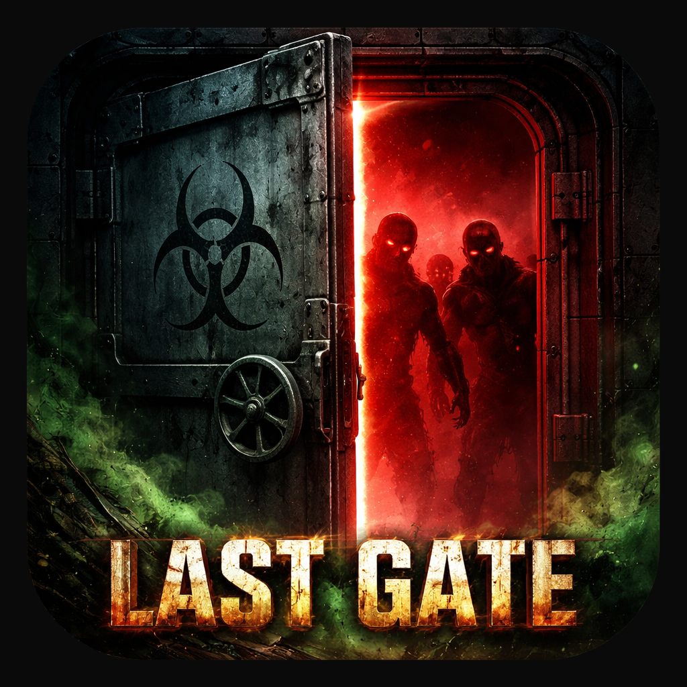
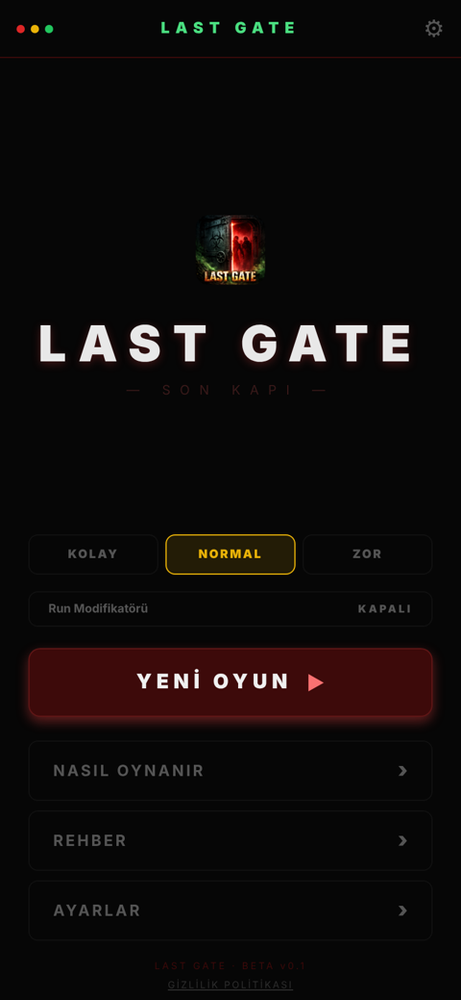
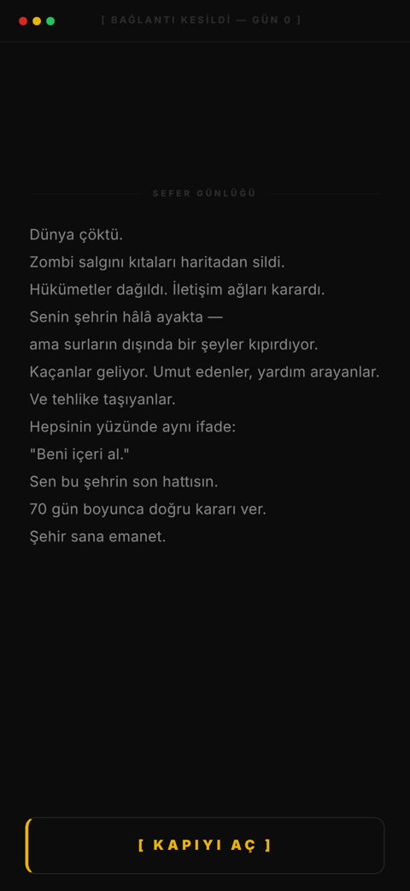
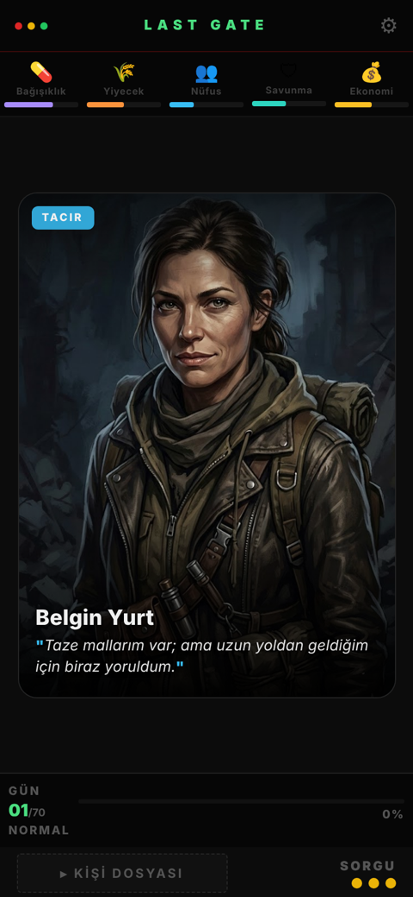
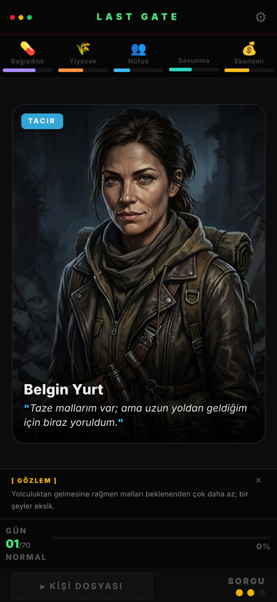
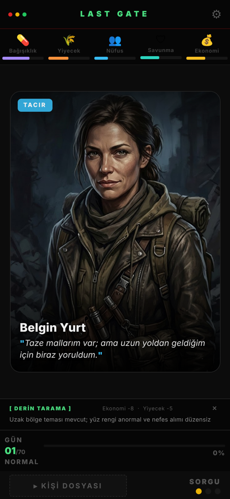

<div align="center">



# LastGate

**A post-apocalyptic, card-based survival strategy game for iOS and Android.**

*"If this gate falls, the city falls."*

[](https://play.google.com/store/apps/details?id=com.eerenyilmazz.lastgate)


</div>

---

You are the commander of the last gate of the Sector 7 quarantine zone. Every day, strangers arrive asking to be let in. Interrogate them, read between the lines, and decide who enters — one wrong call can bring down the whole city.

The game ships in **Turkish**.

## Screenshots

<p align="center">
  
  
  
  
  
</p>

<p align="center"><sub>Main menu · Story intro · How to play · Arrival card · Deep-scan interrogation</sub></p>

## Table of Contents

- [Gameplay](#gameplay)
- [Core Stats](#core-stats)
- [Difficulty](#difficulty)
- [Run Modifiers](#run-modifiers)
- [Characters](#characters)
- [Interrogation](#interrogation)
- [Progression](#progression)
- [Events](#events)
- [End Conditions](#end-conditions)
- [Tech Stack](#tech-stack)
- [Getting Started](#getting-started)
- [Privacy](#privacy)

## Gameplay

### Daily loop

```
Start of day → Arrivals → Decisions (×1–3) → Day summary → Construction → [repeat]
```

At the end of each day the engine resolves, in order: passive building bonuses → role synergies → food consumption (`population × 0.04`) → cascading penalties → delayed character effects → event checks.

### Controls

| Gesture | Action |
|---|---|
| Swipe right | **Accept** |
| Swipe left | **Reject** |
| Tap | **Interrogate** |

> Accepting everyone is not the optimal strategy — for roughly **35%** of arrivals, rejecting is clearly the better choice.

## Core Stats

| Stat | Start | Max | Critical | At zero |
|---|---|---|---|---|
| 💊 Immunity | 65 | 100 | 15 | Plague |
| 🌾 Food | 100 | 200 | 35 | Starvation |
| 👥 Population | 50 | 150 | 25 | Extinction |
| 🛡 Defense | 45 | 100 | 10 | Breach |
| 💰 Economy | 50 | 100 | 5 | Collapse |

### Cascading penalties

While a stat is below its critical threshold it drags others down every day:

| Critical stat | Daily cascade |
|---|---|
| Immunity | Population −1 |
| Food | Economy −2, Defense −1 |
| Defense | Food −4, Economy −3, Population −2 |
| Economy | Food −3, Defense −2 |
| Population | Economy −3, Defense −2 |

## Difficulty

| | Easy | Normal | Hard |
|---|---|---|---|
| Days to survive | 100 | 70 | 50 |
| Daily food bonus | +2 | 0 | −3 |
| Negative character effects | ×0.75 | ×1.0 | ×1.3 |
| Starting stats | +30% | Base | −25% |

## Run Modifiers

When enabled in settings, a random rule activates after day 1 and stays visible in the HUD and the expedition log. There are **16 modifiers**:

| Type | Examples |
|---|---|
| Harder | Famine (food ×1.5), Shadow Plague (−20 immunity), Paranoia (negative effects ×1.5) |
| Easier | Golden Age (negative effects ×0.7), Free Scouting, Supply Day (+food / economy) |
| Role-focused | Age of Medicine (Doctors ×2), Wartime (Soldiers ×2), Trade Era (Traders ×2) |

## Characters

**154 unique characters** across six roles. Roughly 40% are clear accepts, 30% are trade-offs and 30% are liabilities you should turn away.

| Role | Strength | Watch out for |
|---|---|---|
| Doctor | Immunity | An infected doctor costs immunity |
| Farmer | Food | Burdened farmers add food costs |
| Soldier | Defense | Suspicious soldiers may sabotage |
| Trader | Economy | Liars deliver less than they promise |
| Engineer | Economy + Defense | Usually worth accepting |
| Scavenger | Food + Economy | The least predictable role |

### Hidden traits

| Trait | Share | Evades detection | Effect |
|---|---|---|---|
| 🦠 Infected | 15% | 10% | Accepting lowers immunity |
| 🕵️ Spy | 10% | 15% | −4 defense every 3 days, sabotage on day 10 |
| 💸 Thief | 10% | — | Steals economy and food on days 2 and 5 |
| 🛡 Guardian | 6% | — | Hidden one-time bonus |
| 🎭 Liar | 15% | 30% | Positive accept effects scaled ×0.3 |

### Memory and returns

- **Delayed effects** — 53 characters trigger a stat change a set number of days after you accept them.
- **Returning characters** — 45 follow-up encounters bring characters back later with a new decision to make.

### Role synergies

| Role | Minimum | Daily bonus |
|---|---|---|
| Doctor | 3+ | +3 immunity |
| Farmer | 2+ | +4 food |
| Soldier | 2+ | +3 defense |
| Trader | 2+ | +4 economy, +2 food |
| Engineer | 3+ | +2 immunity, +2 economy |
| Scavenger | 2+ | +3 food, +2 economy |

## Interrogation

You have **3 charges per day** (+1 with a Watchtower):

| Use | Cost |
|---|---|
| 1st | Free |
| 2nd — deep scan | −8 economy, −5 food |
| 3rd — second scan | −10 economy, −6 defense, −3 immunity |

## Progression

**Settlement Points (SP)** carry over between runs and are spent on buildings and abilities.

| Action | SP |
|---|---|
| Each day survived | +4 |
| Correct decision | +1 |
| Event survived | +3 |
| Perfect day | +6 |
| Game over | +5 |

A full 100-day victory yields about **670 SP**, while unlocking every building costs 665 SP and every ability 590 SP — you cannot unlock everything in a single run.

### Buildings (permanent)

| Building | SP | Unlocks | Bonus |
|---|---|---|---|
| 🌾 Farm | 40 | Day 3 | +3 food / day |
| 🏪 Market | 45 | Day 4 | +3 economy / day, resource conversion |
| 🏥 Hospital | 55 | Day 5 | +2 immunity / day, infection −20% |
| ⛺ Shelter | 50 | Day 6 | +3 population / day |
| 🗼 Watchtower | 65 | Day 7 | +3 defense / day, +1 interrogation |
| 💧 Water Purifier | 70 | Day 9 | +1 immunity, +2 population / day |
| 🔬 Laboratory | 85 | Day 11 | Infection detection +30% |
| ⚔️ Armory | 80 | Day 14 | +5 defense / day |
| ☢️ Nuclear Generator | 175 | Day 22 | +2 immunity, +2 food / day |

### Abilities (single use)

| Ability | SP | Unlocks | Effect |
|---|---|---|---|
| 📦 Emergency Supply | 40 | Day 1 | +40 food |
| 🚨 Evacuation | 65 | Day 5 | +50 population |
| 💎 Trade Deal | 35 | Day 7 | +20 economy |
| 🧪 Biohazard Response | 60 | Day 9 | +40 immunity |
| 📣 Public Appeal | 55 | Day 10 | +25 population |
| 🛡 Defense Line | 75 | Day 13 | +35 defense |
| 💉 Medical Intervention | 45 | Day 15 | +20 immunity |
| 💹 Economic Bailout | 85 | Day 18 | +35 economy, +20 food |
| ⚡ General Mobilization | 130 | Day 30 | +10 to every stat |

## Events

66 unique events, each triggered at most once per run, with three choices — some grant extra rewards if you have certain roles inside the walls.

Categories: Zombie Combat (12) · Disease (10) · Exploration (10) · Politics (10) · Morale (8) · Crisis (5) · Defense (3) · Espionage (2) · Health (2) · Economy (2) · Population (2)

## End Conditions

| Condition | Trigger |
|---|---|
| 🌾 Starvation | Food reaches 0 |
| 🦠 Plague | Immunity reaches 0 |
| 🛡 Breach | Defense reaches 0 |
| 💀 Extinction | Population reaches 0 |
| 💸 Collapse | Economy reaches 0 |
| 🏆 Victory | Final day of the chosen difficulty completed |

## Tech Stack

| Area | Technology |
|---|---|
| Framework | React Native 0.81 · Expo SDK 54 |
| Language | TypeScript |
| State | Zustand |
| Animation & gestures | Reanimated 4 · Gesture Handler |
| Persistence | AsyncStorage |
| Audio & haptics | Expo AV · Expo Haptics |
| Monetization | Google Mobile Ads (rewarded) |
| Crash reporting | Sentry |
| Builds | EAS |

### Project structure

```
src/
├── screens/      Splash, Menu, Game, Building, GameOver, Summary
├── components/   Card/, HUD/, Overlays/
├── store/        useGameStore, useStatStore, useProgressStore, useSettingsStore
├── domain/       StatEngine, HiddenSystem, ReturnSystem, EventManager, NPCGenerator, SaveSystem
├── hooks/        useGameLoop, useAudio, useRewardedAd
└── data/         config, ui, theme, events, scenarios, followups, modifiers, disasters (JSON)
```

Game balance lives in `src/data/*.json`, so tuning does not require code changes.

Save data is stored under five AsyncStorage keys: `lastgate_game`, `lastgate_stats`, `lastgate_progress`, `lastgate_npc_queue`, `lastgate_settings`.

## Getting Started

**Prerequisites:** Node.js 20+, npm, and the Expo Go app or an Android/iOS simulator.

```bash
git clone https://github.com/eerenyilmazz/LastGate.git
cd LastGate
npm install
npx expo start
```

Ads and Sentry are native modules; use a development build (`npx expo run:android` / `npx expo run:ios`) to exercise them.

Optional environment variables:

| Variable | Purpose |
|---|---|
| `ADMOB_ANDROID_ID` | Overrides the AdMob Android app ID from `src/data/config.json` |
| `SENTRY_DSN` | Enables Sentry crash reporting |

## Privacy

See the [privacy policy](https://statuesque-biscochitos-fb477f.netlify.app/) (source in [`docs/privacy-policy.html`](docs/privacy-policy.html)).

---

<div align="center"><sub>Beta v0.1 · Sector 7</sub></div>
